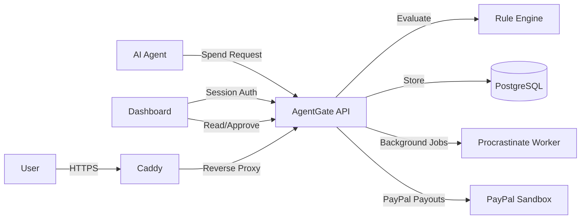

# AgentGate Architecture

## System Overview

AgentGate is a spend-control firewall that sits between AI agents and payment providers (currently PayPal). An AI agent submits a spend request; AgentGate evaluates it against deterministic policy rules and decides **allow**, **deny**, or **needs human approval**. Every decision is recorded in an append-only, hash-chained audit log.

## Technology Stack

| Layer | Technology |
|---|---|
| Backend | Django 4.x + Django REST Framework (Python 3.13) |
| Frontend | React 19 + TypeScript (Vite 8) |
| Database | PostgreSQL 17 |
| Background Jobs | Procrastinate (Redis 7 broker) |
| Reverse Proxy | Caddy 2 (auto TLS via Let's Encrypt) |
| Containerization | Docker Compose |
| Desktop Wrapper | Tauri 2 (optional) |

## High-Level Components

### Backend (`backend/`)

The Django application is split into focused apps:

| App | Responsibility |
|---|---|
| `accounts` | User model, org membership, roles, auth, MFA, password reset |
| `agents` | Agent CRUD, API key management (hashed storage) |
| `policies` | Versioned policy model, merchant rules |
| `payees` | Known payment destinations per merchant |
| `spend` | Spend request submission pipeline, idempotency |
| `approvals` | Approval queue, human approve/deny with recheck |
| `payments` | PayPal client, webhook handling, reconciliation |
| `audit` | Append-only hash-chained audit events |
| `common` | Shared error envelope, middleware, utilities |
| `background` | Procrastinate job definitions |

### Rule Engine (`backend/engine/`)

Pure Python — imports neither Django nor application code. `evaluate(spend, limits, spent)` returns a decision plus every rule that fired. Enforced by `.importlinter`. Rules R01–R16 cover agent status, currency, merchant allow/block lists, per-transaction cap, daily/weekly/monthly budgets, velocity, merchant-window spend, approval threshold, untrusted source, and deterministic injection patterns.

### Frontend (`frontend/`)

React SPA with TypeScript, built with Vite. Key areas:

| Directory | Purpose |
|---|---|
| `src/api/` | API client, typed endpoints, `useApiResource` hook |
| `src/pages/app/` | Dashboard pages (agents, approvals, transactions, policies, audit, settings, simulate) |
| `src/pages/auth/` | Authentication pages (login, register, MFA, password reset) |
| `src/pages/landing/` | Public landing page, system requirements, downloads |
| `src/pages/live/` | Live API tester |
| `src/session/` | Auth context, session guards, protected routes |
| `src/ui/` | Shared UI components (layout, badges, modals, toasts) |
| `src/tokens.css` | Design tokens (colors, typography, spacing, shadows) |
| `src/styles/` | Global and page-specific styles |

### Deployment

Docker Compose with four services: Caddy (edge), web (gunicorn), worker (Procrastinate), Redis. PostgreSQL is external (Neon managed). See `compose.yaml` and `docs/deployment/CONTABO_DEPLOYMENT.md`.

## API Structure

All API endpoints are versioned under `/v1/`. Agent-key endpoints use `Authorization: Bearer <key>`. Dashboard endpoints use Django session authentication.

| Endpoint | Auth | Description |
|---|---|---|
| `GET /healthz` | None | Liveness probe |
| `GET /readyz` | None | Readiness probe (DB check) |
| `POST /v1/spend-requests/` | Agent key | Submit spend request |
| `GET /v1/spend-requests/` | Session | List spend requests |
| `GET /v1/spend-requests/{id}/` | Agent key or session | Get spend request |
| `GET /v1/approvals/` | Session (approver/admin) | List pending approvals |
| `POST /v1/approvals/{id}/approve/` | Session (approver/admin) | Approve with recheck |
| `POST /v1/approvals/{id}/deny/` | Session (approver/admin) | Deny approval |
| `GET /v1/policies/` | Session | List policies |
| `GET /v1/audit/` | Session | List audit events |
| `GET /v1/audit/verify/` | Session (admin) | Verify audit chain |
| `POST /webhooks/paypal/` | PayPal signature | PayPal webhook handler |

Full API documentation is available at `/api/docs/` (Swagger UI) when the backend is running.

## Database & Persistence

PostgreSQL 17 is required for migrations (Procrastinate uses PostgreSQL-only schema). Money is stored as integer minor units with ISO-4217 currency codes. The audit log uses a hash chain per organization with a PostgreSQL trigger blocking direct UPDATE/DELETE/TRUNCATE.

## Authentication & Authorization

- **Agent API**: Bearer token authentication via hashed API keys. Keys are stored as SHA-256 hashes; raw key shown once at creation.
- **Dashboard**: Django session auth with custom User model. Roles from `OrgMembership`: admin, approver, viewer.
- **MFA**: TOTP-based with encrypted secrets (Fernet). Recovery codes available.
- **GitHub OAuth**: Optional social login via allauth.
- **Org-scoping**: All querysets and permission checks filter by the authenticated user's organization memberships. Client-supplied org IDs are never trusted.

## Payment Integration Boundaries

PayPal integration is sandbox-only. The agent never receives PayPal credentials. Payment execution uses a compare-and-swap pattern to prevent double-payment. Webhooks are signature-verified and deduplicated. `PAYMENT_EXECUTOR=fake` (default) performs no actual PayPal calls. Production deployment does not include PayPal credentials.

**PayPal AI Toolkit** is a separate external integration. Its direct PayPal requests are NOT routed through AgentGate's policy engine.

## Security & Privacy

- API keys stored as SHA-256 hashes, shown once at creation
- Audit log is append-only, hash-chained per organization
- Deterministic injection pattern screening (NFKC normalization, homoglyph folding)
- AI classification is advisory only; deterministic policy is authoritative
- Request idempotency via `Idempotency-Key` header
- Per-agent write throttling, 64 KiB body cap
- Bidi-override and control character sanitization
- CSP, X-Frame-Options, HSTS enforced at Caddy edge

## Testing Strategy

- **Backend**: Django test suite with SQLite by default, PostgreSQL in CI. Rule engine unit tests, concurrency tests (PostgreSQL row locks), property-based tests.
- **Frontend**: Node test runner (`node --test`) for API contract, UX audit, and component tests. ESLint for code quality.
- **CI**: GitHub Actions runs backend tests against PostgreSQL 17, frontend lint + build + tests, security audit, and deployment config validation.
