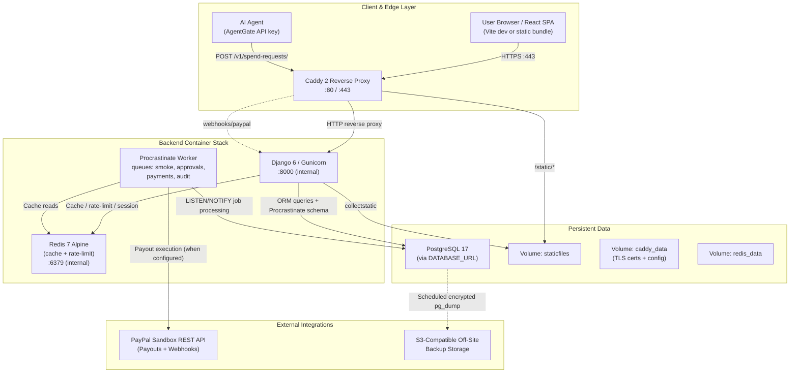

# AgentGate System Architecture

This document describes the actual implemented and verified architecture
of AgentGate as of branch `release/v0.1.0-ux-demo`
(HEAD `fbe9323c0d4411dfcccf51760bfbf7fac33b4202`).

---

## 1. Service Map



---

## 2. Component Inventory

| Component | Type | Role | Required deps | Ports / volumes |
|---|---|---|---|---|
| **Caddy** | Reverse proxy | TLS termination, static-file serving, security headers, HTTP routing | None (Alpine container) | Public `:80`, `:443`; volumes `caddy_data`, `staticfiles` (read-only) |
| **Web** | Django 6 / Gunicorn | DRF API, headless session auth (allauth), policy engine, admin | PostgreSQL 17, Redis | Internal only; volume `staticfiles` (write) |
| **Worker** | Procrastinate CLI | Background queue consumer for approval expiry, payment execution, reconciliation, audit anchoring | PostgreSQL 17, Redis | Internal only; no HTTP port |
| **Redis 7** | In-memory store | Cache, rate-limiting, session TTL, ephemeral worker state | None | Internal only; volume `redis_data` |
| **PostgreSQL 17** | Relational DB | All authoritative data, append-only audit trail, Procrastinate job tables | None (external managed or separate container) | Never published publicly |
| **Frontend SPA** | React 19 + TS + Vite | Dashboard, auth flows, demo simulator | Served as compiled static assets from `staticfiles` via Caddy; or Vite dev server in development | Vite dev: `:5173` (local only) |

---

## 3. Request Lifecycle and Security Boundary

```mermaid
sequenceDiagram
    autonumber
    actor Agent as AI Agent
    participant Gate as AgentGate API
    participant Classifier as AI Classifier (Advisory only)
    participant Policy as Deterministic Rules Engine
    participant Approval as Human Approver
    participant PayPal as PayPal Sandbox
    participant Audit as Append-Only Audit Log

    Agent->>Gate: POST /v1/spend-requests/ (amount, merchant, purpose, provenance)
    Note over Gate: Idempotency check; 409 on key-body mismatch
    Gate->>Classifier: Screen text for injection patterns (R14) + optional advisory score
    Classifier-->>Gate: ScreeningResult — advisory only; never overrides deterministic rules
    Gate->>Policy: Evaluate R01–R16 (caps, budgets, merchant list, velocity, payee cooldown)
    alt DENY — hard rule broken
        Gate->>Audit: Record SpendRequest(DENIED) + AuditEvent
        Gate-->>Agent: 403 Forbidden — never reaches PayPal
    else ALLOW — all rules pass
        Gate->>Audit: Record SpendRequest(APPROVED) + AuditEvent
        Gate->>PayPal: Execute payout (sandbox REST, only if PAYMENTS_EXECUTION_ENABLED)
        PayPal-->>Gate: Payout reference + status
        Gate->>Audit: Record PAYMENT_EXECUTING / PAYMENT_COMPLETED
        Gate-->>Agent: 201 Created
    else NEEDS_APPROVAL — approval threshold or escalation rule fired
        Gate->>Audit: Record SpendRequest(PENDING_APPROVAL) + Approval record
        Gate-->>Agent: 202 Accepted — not sent to PayPal
        Approval->>Gate: POST /v1/approvals/:id/approve/ or /deny/
        alt Human approves
            Gate->>Audit: Record Approval(APPROVED)
            Gate->>PayPal: Execute payout
            PayPal-->>Gate: Payout reference
            Gate->>Audit: Record PAYMENT_COMPLETED
        else Human denies or approval expires
            Gate->>Audit: Record Approval(DENIED / EXPIRED)
        end
    end
```

**Security invariant:** The AI classifier output (`ClassifierResult.score`) contributes
only to the advisory risk score. It is added to the display score in `scoring.py` and
sets `R15_INJECTION_CLASSIFIER` as a `needs_approval` reason if the threshold is
exceeded — it **never** converts a `DENY` to `ALLOW` or bypasses a hard rule.
Verified by `tests/test_classifier.py` and `tests/test_rules.py`.

---

## 4. Architecture Decision Notes

### 4.1 Frontend is fully separate from the backend at runtime

The React SPA is compiled to a static bundle by Vite and served from the `staticfiles`
volume via Caddy. It does **not** run inside the Django process. In development,
Vite's dev server runs at `:5173` and proxies `/api`, `/v1`, `/webhooks`, and
`/healthz` to the Django dev server at `:8000`.

### 4.2 Dashboard simulator is client-side only

The in-app policy simulator, approval queue, payment outcomes, and audit log visible
in the React dashboard are **browser-memory state** (`frontend/src/demo/store.ts`).
They are not records in the PostgreSQL database. The separate "Live API tester" screen
does submit real requests to the backend via `/v1/spend-requests/`.

### 4.3 PostgreSQL 17 is required for migrations

Procrastinate's migration (`apps/background`) uses `CREATE EXTENSION IF NOT EXISTS unaccent`
and PostgreSQL-only SQL. The Django test suite uses SQLite and skips those migrations via
`MIGRATION_MODULES = {"procrastinate": None}`. **Local development and production require
PostgreSQL 17** — do not substitute SQLite or PostgreSQL 18 without verifying all migrations.

### 4.4 PayPal is Sandbox-only

The `PayPalClient` in `apps/payments/paypal/client.py` refuses `mode="live"` unless
`PAYPAL_ALLOW_LIVE=1` is explicitly set. The production `compose.yaml` deliberately
excludes PayPal credentials. Payment execution defaults to `FakeExecutor` and is only
activated when `PAYMENT_EXECUTOR=paypal` and `PAYMENTS_EXECUTION_ENABLED=true` are set.

### 4.5 Audit log is append-only and hash-chained

`apps/audit/models.py` maintains a hash chain per organization. When `AUDIT_ANCHOR_PATH`
points to off-database storage the head hash is anchored hourly; without it the trail is
tamper-evident. Records are never deleted through normal application paths.

### 4.6 Worker and web share the same Docker image

Both the `web` and `worker` containers in `compose.yaml` use the same `agentgate-web:latest`
image built from the root `Dockerfile`. The `CMD` is overridden per service.

---

## 5. Architecture Questions — Answered

| Question | Answer |
|---|---|
| Which components run as separate services? | caddy, web, worker, redis — four containers. PostgreSQL is external or a fifth container. |
| Which services require PostgreSQL? | web, worker |
| Which services require Redis? | web (cache, rate-limit), worker (cache) |
| Is there a separate worker? | Yes — Procrastinate worker, same Docker image, different CMD |
| How are frontend assets served? | Compiled by Vite → `staticfiles` volume → Caddy `/static/*` |
| Backend serves frontend? | No. Static bundle via Caddy. Dev: separate Vite dev server. |
| Persistent storage needs | PostgreSQL: data; Redis: `appendonly yes` for transient crash recovery; Caddy: TLS certs; staticfiles: compiled front end |
| Ports exposed publicly | 80, 443 (Caddy only) |
| Health checks | Caddy: Caddy admin API; web: `GET /healthz` (HTTP 200); no worker health endpoint |
| Production startup commands | web: `gunicorn config.wsgi:application`; worker: `python manage.py procrastinate worker` |
| Required secrets | `DJANGO_SECRET_KEY`, `DATABASE_URL`, `REDIS_URL`+`REDIS_PASSWORD`, `MFA_ENCRYPTION_KEY`, `DOMAIN`, `CSRF_TRUSTED_ORIGINS`, `FRONTEND_ORIGIN`, `PAYPAL_*` (when executor=paypal) |
| PostgreSQL-version-specific migrations? | Yes — `apps/background` uses `CREATE EXTENSION` and PostgreSQL-only SQL. Requires PG 17. |
